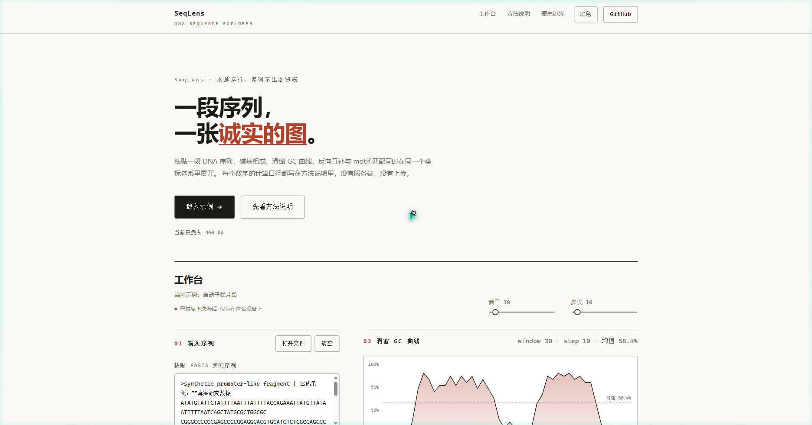
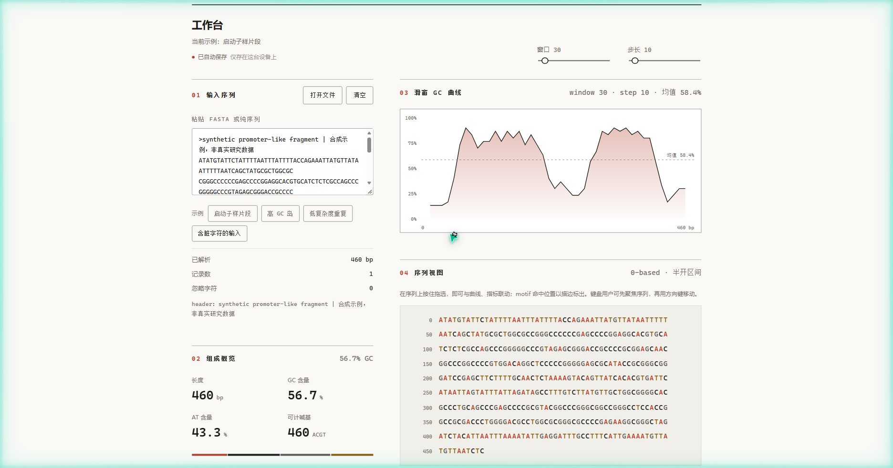
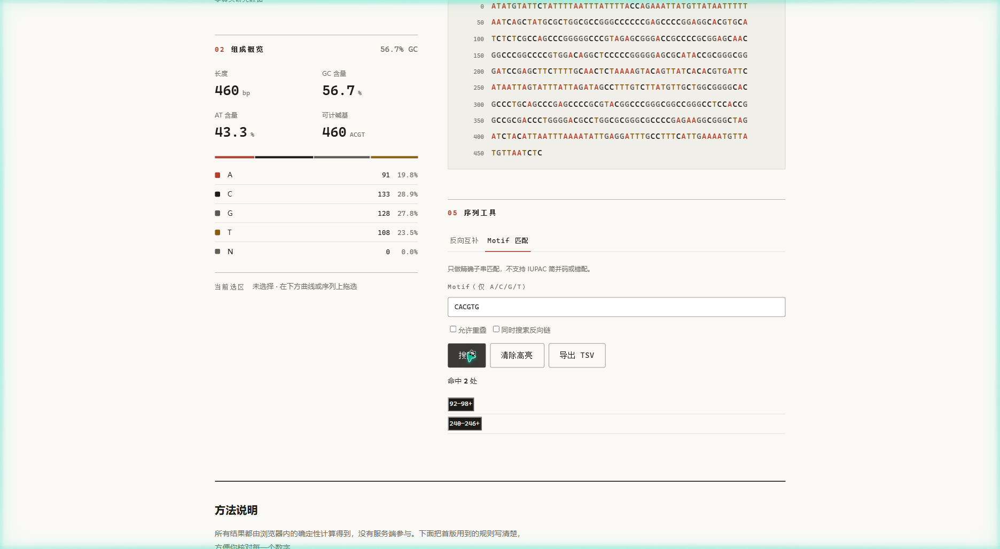
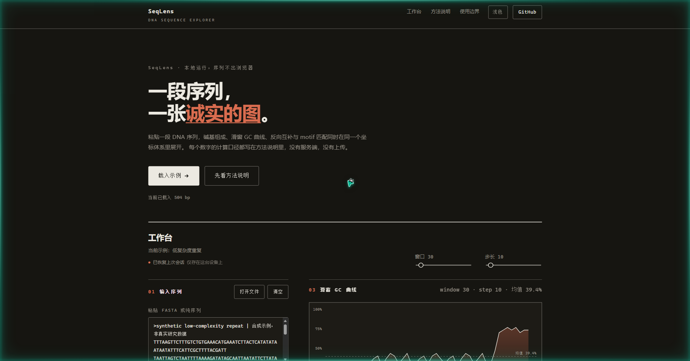

# SeqLens

> 一段序列，一张诚实的图。

SeqLens 是一个**本地优先**的 DNA 序列可视化学习工具，页面标题为「SeqLens · 交互式 DNA 序列观察台」。粘贴 FASTA 或纯序列，同一个工作台里会同时展开碱基组成、滑窗 GC 曲线、序列视图、反向互补与 motif 精确匹配，并让图表、序列、坐标三者双向联动。

所有计算都在浏览器里完成，没有服务端，序列不会离开你的电脑。默认浅色（暖纸白，「实验记录纸」风格），一键可切深色暖黑主题。

**在线试用：[https://haomiaoyan.github.io/seqlens/](https://haomiaoyan.github.io/seqlens/)**

[](https://github.com/haomiaoyan/seqlens/actions/workflows/deploy.yml)
[](LICENSE)



## 它能做什么

| 功能 | 说明 |
| --- | --- |
| 输入清洗 | 粘贴 FASTA 或纯序列，也可「打开文件」读取本地 `.fa/.fasta/.fna/.txt`（单文件 ≤ 8 MB）；大小写不敏感，忽略空白、行号、`;` 注释行，只保留 A/C/G/T/N，其余字符丢弃并计数提示 |
| 碱基组成 | A/C/G/T/N 计数与占比条，GC 含量按 `(G+C)/(A+C+G+T)` 计算，N 不进分母；无 A/C/G/T 时 GC 记 0% |
| 滑窗 GC 曲线 | 窗口 5–500 bp、步长 1–200 bp 可调，悬停读数，拖选区域，横坐标取窗口中点 |
| 序列视图 | 按面板实测宽度自适应每行碱基数（10–60，取 5 的倍数），指针拖选，motif 命中位置描边，与曲线共用同一套 0-based 坐标 |
| 双向联动 | 拖选曲线 ↔ 高亮序列；点击命中芯片 ↔ 跳到对应碱基 |
| 反向互补 | A↔T、C↔G、N 保持不变、顺序反转，可复制或导出 FASTA |
| Motif 匹配 | 精确子串匹配，支持重叠开关与正/反链同时搜索，命中列表可点选跳转、导出 TSV（最多显示前 200 处，完整结果在文件里） |
| 主题切换 | 浅色默认 / 深色暖黑一键切换，选择存在本机，跨标签页同步，首帧前应用避免闪屏 |
| 会话保留 | 序列与窗口参数自动存在本机浏览器，刷新后接着用；不联网、不上传 |
| 错误兜底 | 每个面板独立 `ErrorBoundary`，单个面板渲染失败不会整页白屏 |



## 使用示例

1. 打开页面，点首屏的「载入示例」，或粘贴一段自己的 FASTA。工作台按 01 输入 → 02 组成 → 03 曲线 → 04 序列 → 05 工具 排布。
2. 在 05「序列工具」切到 **Motif 匹配**，输入 `CACGTG`（仅 A/C/G/T），点「搜索」。启动子示例会命中 2 处（92–98、240–246）。
3. 点击任一命中芯片，序列视图会滚动到该位置并框出命中碱基；也可以直接在 04 序列视图或 03 曲线上按住拖选，两者坐标实时联动。需要保存就点「导出 TSV」，或切到「反向互补」复制结果 / 导出 FASTA。

搜索 `CACGTG` 后，命中位置在序列视图里被描边，工具面板列出可点选的命中芯片：



## 快速开始

需要 Node.js 18 或更高版本（CI 使用 Node 22）。

**Windows 用户最省事的方式**：双击项目根目录里的 `启动.bat`。它会检查 Node、首次自动装依赖、打开浏览器，然后启动开发服务器。窗口不要关，关掉服务器就停了。

手动命令：

```bash
cd "D:\ai项目（自用）\seqlens"   # 进到项目目录
npm install                      # 只需第一次，装依赖
npm run dev                      # 启动开发服务器
```

`npm run dev` 跑起来后终端会打印：

```
  VITE v6.x.x  ready in 500 ms

  ➜  Local:   http://localhost:5173/
```

按住 Ctrl 点那个链接（或手动在浏览器打开 http://localhost:5173 ）就能看到页面。改代码会热更新，不用重启。要停止就回终端按 `Ctrl + C`。

> 注意：`cd`、`npm install`、`npm run dev` 是**三条独立的命令**，要一行一条敲、等上一条跑完再敲下一条。`npm install` 只需要成功跑一次，之后每次只跑 `npm run dev`。

生产构建与本地预览：

```bash
npm run build    # tsc 类型检查 + vite 构建，产物在 dist/
npm run preview  # 预览 dist/，默认 http://localhost:4173
```

运行测试、类型检查、lint 与格式检查：

```bash
npm test            # Vitest 单元测试（当前 72 个）
npm run typecheck   # tsc --noEmit
npm run lint        # ESLint
npm run format:check # Prettier 只检查不改写
npm run format      # Prettier 改写
npm run check       # 以上全部串起来跑一遍，CI 同款
```

`npm run check` 是提交前最省事的自检：类型、lint、格式、单测任一不过都会报错退出。

## 主题切换

页头右侧的「深色 / 浅色」按钮用于切换主题：默认是浅色暖纸白，点击切到深色暖黑（见下图），再点切回。按钮文字显示的是**切换后的目标主题**。

- 主题选择单独存在 `localStorage` 的 `seqlens.theme.v1`，与序列会话（`seqlens.session.v1`）互不影响——换主题不算动过数据，不会触发会话保存。
- `index.html` 在首帧渲染前读取一次主题，深色用户不会先看到一帧白屏。
- 监听 `storage` 事件：同一浏览器、同一来源下另一个标签页切换主题，本页会实时跟随。
- 浏览器禁用存储时静默降级为默认浅色，本次会话内切换仍然生效，只是不持久化。



## 部署到 GitHub Pages

本仓库已部署在 **<https://haomiaoyan.github.io/seqlens/>**，`main` 分支每次 push 都会自动发布。

如果你想 fork 一份部署自己的：

1. 在 `src/config.ts` 里把 `GITHUB_URL` 改成你自己的仓库地址。
2. 把整个目录推到 GitHub（默认分支 `main`）。
3. 仓库 **Settings → Pages → Build and deployment → Source** 选 **GitHub Actions**。
   - 也可以跳过这步：workflow 里 `configure-pages` 带了 `enablement: true`，首次运行会自动启用 Pages。
4. 之后每次 push 到 `main`，`.github/workflows/deploy.yml` 会依次跑 lint、格式检查、测试、构建，再发布到 `https://<用户名>.github.io/<仓库名>/`。

`vite.config.ts` 里的 `base: './'` 让产物使用相对路径，因此部署在仓库子路径下也能正常加载资源，无需额外配置。

## 坐标与算法约定

这些约定在代码、测试和界面文案里保持一致，方便你核对每一个数字。

- **坐标**：全部 0-based、半开区间 `[start, end)`。
- **GC 含量**：`(G + C) / (A + C + G + T) × 100`，N 不计入分母，避免稀释比例。
- **滑窗 GC**：窗口从 0 开始按步长前进，不越过序列末端；窗口大于序列长度时退化为覆盖整条序列的单个窗口；横坐标取窗口中点。
- **Motif 匹配**：只做精确子串匹配，不支持 IUPAC 简并码或错配；关闭「允许重叠」时匹配之间不共享碱基；搜索反链时坐标会换算回正链，便于在原序列上高亮。
- **多记录 FASTA**：按出现顺序拼接，header 只保留第一条。
- **长度上限**：序列 10,000 bp，motif 50 bp。超出部分会被截断并在界面上提示。

核心算法集中在 `src/lib/sequence.ts`；测试共 **72 个**，覆盖上述规则、会话存储容错、键盘选区计算（`keyboard.ts`）与序列视图自适应列数（`row-layout.ts`），见 `src/lib/*.test.ts`。

## 键盘操作

曲线和序列视图都可以用键盘操作，不必依赖鼠标拖选：

| 按键 | 作用 |
| --- | --- |
| `Tab` | 依次聚焦输入框、滑杆、曲线、序列视图等控件，焦点环为青色描边 |
| `←` / `→` | 把选区向前/向后移动一个步长（曲线按窗口步长，序列按单个碱基） |
| `Shift` + `←` / `→` | 扩展或收缩选区，而不是整体移动 |
| `PageUp` / `PageDown` | 快速移动（曲线为 10 个步长） |
| `Home` / `End` | 跳到序列开头 / 末尾 |

选区变化会通过 `aria-live` 区域播报"已选择 X 到 Y，共 N 个碱基"，屏幕阅读器用户能听到当前位置。焦点环使用 `:focus-visible`，鼠标点击时不会闪现描边。

## 本地会话

工作台的内容会自动存进浏览器 `localStorage`（键名 `seqlens.session.v1`），刷新或关掉标签页再回来，序列和窗口参数都还在。写操作做了 500 ms 防抖，只存四个字段：原始输入、窗口大小、步长、当前示例 id。

几点行为值得知道：

- 数据**只存在这台设备的这个浏览器**里，不上传任何地方，换设备或换浏览器不会同步。
- 浏览器禁用存储（如 Safari 无痕模式）时，界面会提示"本次内容不会自动保存"，功能其余部分不受影响。
- 首次访问、且没有输入任何内容时不会写空存档，所以不会出现"已恢复上次会话"的误报。
- 点「清空」会同时删掉存档。
- 想手动清除：浏览器开发者工具里执行 `localStorage.removeItem('seqlens.session.v1')`。
- 主题选择存在另一个键 `seqlens.theme.v1`，清空序列不会重置主题。
- 打开带 `?example=` 的分享链接时，界面会先显示那个示例，但**不会**立刻覆盖你原有的存档；只有你自己编辑内容或点示例按钮之后才开始保存。所以别人发来的链接不会弄丢你正在做的序列。

## 项目结构

```
seqlens/
├─ src/
│  ├─ components/       Header（导航 + 主题切换）、Intro（定调区）、SequenceInput、
│  │                    StatsPanel、GcChart、SequenceViewer、ToolsPanel、
│  │                    Sections（方法说明 / 使用边界 / 页脚）、ErrorBoundary
│  ├─ data/examples.ts  4 个确定性合成示例（无真实研究数据）
│  ├─ hooks/            useElementWidth（ResizeObserver 响应式 SVG）、
│  │                    useSessionPersistence（会话读写）、useTheme（浅/深主题）
│  ├─ lib/              sequence.ts（核心算法）、storage.ts（会话存储）、
│  │                    keyboard.ts（键盘选区）、row-layout.ts（序列视图自适应列数）、
│  │                    download.ts（复制 / 导出）及对应单元测试
│  ├─ App.tsx           状态编排：序列、选区、命中、窗口参数
│  ├─ config.ts         应用名、标语、仓库地址、碱基配色变量
│  └─ styles.css        样式入口，引入 styles/ 下四层：
│                        tokens（主题令牌，浅色默认 / 深色切换）、base、components、sections
├─ docs/                README 用的截图（hero / workbench / motif / theme-dark）
├─ public/og.png        社交平台预览图（1200×630）
└─ .github/workflows/   GitHub Pages 自动部署
```

技术栈：Vite 6 + React 18 + TypeScript 5.6 + Vitest 2。图表是手写 SVG，没有引入图表库。代码风格由 ESLint（`typescript-eslint` + `eslint-plugin-react-hooks`）与 Prettier 统一，格式规则见 `.prettierrc.json`。组件层不硬编码色值，颜色统一走 `tokens.css` 里的主题令牌。

提交前请跑 `npm run check`；CI 会在每次 push 到 `main` 时执行 lint、格式检查、测试和构建，不通过就不会部署。

## 示例数据

界面内置 4 个示例：启动子样片段（460 bp）、高 GC 岛（540 bp）、低复杂度重复（504 bp）、含脏字符的输入（272 bp）。全部由固定随机种子合成，**不包含任何真实研究数据**，用于演示交互而非科学分析。

支持深链，例如 `?example=promoter#workbench` 会直接载入示例并跳到工作台，且不会覆盖访客已保存的会话。

## 使用边界

SeqLens 是**教学与轻量探索工具**，适合理解碱基组成与 GC 含量的概念、观察窗口参数如何改变曲线形状、在课堂上演示序列与图形的对应关系、检查短序列的反向互补或精确 motif 位置。

它**不适合**：临床诊断或任何医疗决策；替代 BLAST、序列比对、变异检测、富集分析等专业工具；处理需要保密的人类基因组数据；作为论文或生产流程中的权威计算依据。

结果用于研究或临床场景时，请使用经过验证的专业流程并独立复核。

## 许可证

[MIT](LICENSE) © 2026
