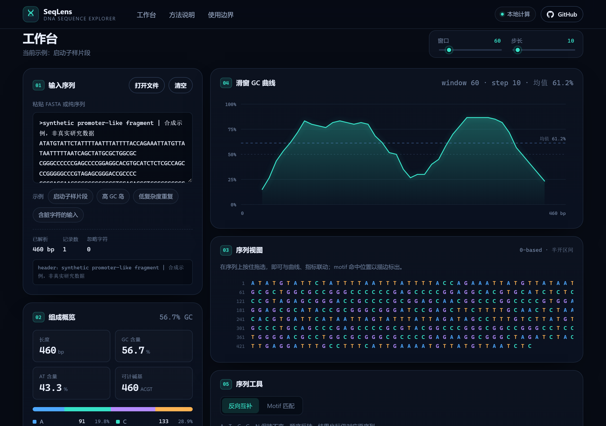
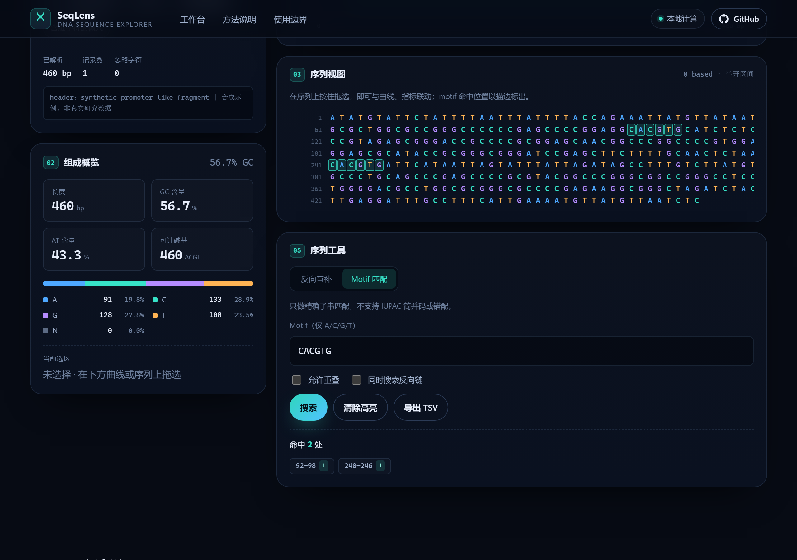

# SeqLens

> 把一段 DNA 序列，变成一张可以探索的图。

SeqLens 是一个**本地优先**的 DNA 序列可视化学习工具。粘贴 FASTA 或纯序列，它会在同一个视图里给出碱基组成、滑窗 GC 曲线、序列视图、反向互补与 motif 精确匹配，并让图表、序列、坐标三者双向联动。

所有计算都在浏览器里完成，没有服务端，序列不会离开你的电脑。

**在线试用：[https://haomiaoyan.github.io/seqlens/](https://haomiaoyan.github.io/seqlens/)**

[](https://github.com/haomiaoyan/seqlens/actions/workflows/deploy.yml)
[](LICENSE)


## 它能做什么

| 功能 | 说明 |
| --- | --- |
| 输入清洗 | 大小写不敏感；忽略空白、行号、`;` 注释行；只保留 A/C/G/T/N，其余字符丢弃并计数 |
| 碱基组成 | A/C/G/T/N 计数与占比，GC 含量按 `(G+C)/(A+C+G+T)` 计算，N 不进分母 |
| 滑窗 GC 曲线 | 窗口 5–500 bp、步长 1–200 bp 可调，鼠标悬停读数，拖选区域 |
| 序列视图 | 60 列/行排版，指针拖选，motif 命中位置描边，与曲线共用同一套坐标 |
| 双向联动 | 拖选曲线 ↔ 高亮序列；点击命中芯片 ↔ 跳到对应碱基 |
| 反向互补 | A↔T、C↔G、N 保持不变、顺序反转，可复制或导出 FASTA |
| Motif 匹配 | 精确子串匹配，支持重叠开关与正/反链同时搜索，结果可导出 TSV |
| 会话保留 | 序列与窗口参数自动存在本机浏览器，刷新后接着用；不联网、不上传 |



搜索 `CACGTG`，命中位置会在序列视图里直接描边：



## 快速开始

需要 Node.js 18 或更高版本。

**Windows 用户最省事的方式**：双击项目根目录里的 `启动.bat`。它会检查 Node、首次自动装依赖、打开浏览器，然后启动开发服务器。窗口不要关，关掉服务器就停了。

手动命令：

```bash
cd "D:\ai项目（自用）\seqlens"   # 进到项目目录
npm install                      # 只需第一次，装依赖
npm run dev                      # 启动开发服务器
```

`npm run dev` 跑起来后终端会打印：

```
  VITE v6.x.x  ready in 500 ms

  ➜  Local:   http://localhost:5173/
```

按住 Ctrl 点那个链接（或手动在浏览器打开 http://localhost:5173 ）就能看到页面。改代码会热更新，不用重启。要停止就回终端按 `Ctrl + C`。

> 注意：`cd`、`npm install`、`npm run dev` 是**三条独立的命令**，要一行一条敲、等上一条跑完再敲下一条。`npm install` 只需要成功跑一次，之后每次只跑 `npm run dev`。

生产构建与本地预览：

```bash
npm run build    # tsc 类型检查 + vite 构建，产物在 dist/
npm run preview  # 预览 dist/，默认 http://localhost:4173
```

运行测试与类型检查：

```bash
npm test
npm run typecheck
```

## 部署到 GitHub Pages

本仓库已部署在 **<https://haomiaoyan.github.io/seqlens/>**，`main` 分支每次 push 都会自动发布。

如果你想 fork 一份部署自己的：

1. 在 `src/config.ts` 里把 `GITHUB_URL` 改成你自己的仓库地址。
2. 把整个目录推到 GitHub（默认分支 `main`）。
3. 仓库 **Settings → Pages → Build and deployment → Source** 选 **GitHub Actions**。
   - 也可以跳过这步：workflow 里 `configure-pages` 带了 `enablement: true`，首次运行会自动启用 Pages。
4. 之后每次 push 到 `main`，`.github/workflows/deploy.yml` 会自动跑测试、构建并发布到 `https://<用户名>.github.io/<仓库名>/`。

`vite.config.ts` 里的 `base: './'` 让产物使用相对路径，因此部署在仓库子路径下也能正常加载资源，无需额外配置。

## 坐标与算法约定

这些约定在代码、测试和界面文案里保持一致，方便你核对每一个数字。

- **坐标**：全部 0-based、半开区间 `[start, end)`。
- **GC 含量**：`(G + C) / (A + C + G + T) × 100`，N 不计入分母，避免稀释比例。
- **滑窗 GC**：窗口从 0 开始按步长前进，不越过序列末端；窗口大于序列长度时退化为覆盖整条序列的单个窗口；横坐标取窗口中点。
- **Motif 匹配**：只做精确子串匹配，不支持 IUPAC 简并码或错配；关闭「允许重叠」时匹配之间不共享碱基；搜索反链时坐标会换算回正链，便于在原序列上高亮。
- **多记录 FASTA**：按出现顺序拼接，header 只保留第一条。
- **长度上限**：序列 10,000 bp，motif 50 bp。超出部分会被截断并在界面上提示。

核心算法集中在 `src/lib/sequence.ts`，单元测试共 61 个，覆盖上述规则、会话存储的容错逻辑以及键盘选区计算（`src/lib/sequence.test.ts`、`src/lib/storage.test.ts`、`src/lib/keyboard.test.ts`）。

## 键盘操作

曲线和序列视图都可以用键盘操作，不必依赖鼠标拖选：

| 按键 | 作用 |
| --- | --- |
| `Tab` | 依次聚焦输入框、滑杆、曲线、序列视图等控件，焦点环为青色描边 |
| `←` / `→` | 把选区向前/向后移动一个步长（曲线按窗口步长，序列按单个碱基） |
| `Shift` + `←` / `→` | 扩展或收缩选区，而不是整体移动 |
| `PageUp` / `PageDown` | 快速移动（曲线为 10 个步长） |
| `Home` / `End` | 跳到序列开头 / 末尾 |

选区变化会通过 `aria-live` 区域播报"已选择 X 到 Y，共 N 个碱基"，屏幕阅读器用户能听到当前位置。焦点环使用 `:focus-visible`，鼠标点击时不会闪现描边。

## 本地会话

工作台的内容会自动存进浏览器 `localStorage`（键名 `seqlens.session.v1`），刷新或关掉标签页再回来，序列和窗口参数都还在。写操作做了 500 ms 防抖，只存四个字段：原始输入、窗口大小、步长、当前示例 id。

几点行为值得知道：

- 数据**只存在这台设备的这个浏览器**里，不上传任何地方，换设备或换浏览器不会同步。
- 浏览器禁用存储（如 Safari 无痕模式）时，界面会提示"本次内容不会自动保存"，功能其余部分不受影响。
- 首次访问、且没有输入任何内容时不会写空存档，所以不会出现"已恢复上次会话"的误报。
- 点「清空」会同时删掉存档。
- 想手动清除：浏览器开发者工具里执行 `localStorage.removeItem('seqlens.session.v1')`。
- 打开带 `?example=` 的分享链接时，界面会先显示那个示例，但**不会**立刻覆盖你原有的存档；只有你自己编辑内容或点示例按钮之后才开始保存。所以别人发来的链接不会弄丢你正在做的序列。

## 项目结构

```
seqlens/
├─ src/
│  ├─ components/     Header、Hero、输入、组成、GC 曲线、序列视图、工具面板、方法/边界区
│  ├─ data/examples.ts  4 个确定性合成示例（无真实研究数据）
│  ├─ hooks/          useElementWidth（ResizeObserver 驱动响应式 SVG）、useSessionPersistence
│  ├─ lib/            sequence.ts（核心算法）、storage.ts（会话读写）、keyboard.ts（键盘选区计算）、download.ts、单元测试
│  ├─ App.tsx         状态编排：序列、选区、命中、窗口参数
│  ├─ config.ts       应用名、标语、仓库地址
│  └─ styles.css      深色主题的设计 token 与全部样式
├─ docs/              README 用的截图
└─ .github/workflows/ GitHub Pages 自动部署
```

技术栈：Vite 6 + React 18 + TypeScript 5.6 + Vitest 2。图表是手写 SVG，没有引入图表库。

## 示例数据

界面内置 4 个示例：启动子样片段（460 bp）、高 GC 岛（540 bp）、低复杂度重复（504 bp）、含脏字符的输入（272 bp）。全部由固定随机种子合成，**不包含任何真实研究数据**，用于演示交互而非科学分析。

支持深链，例如 `?example=promoter#workbench` 会直接载入示例并跳到工作台。

## 使用边界

SeqLens 是**教学与轻量探索工具**，适合理解碱基组成与 GC 含量的概念、观察窗口参数如何改变曲线形状、在课堂上演示序列与图形的对应关系。

它**不适合**：临床诊断或任何医疗决策；替代 BLAST、序列比对、变异检测、富集分析等专业工具；处理需要保密的人类基因组数据；作为论文或生产流程中的权威计算依据。

结果用于研究或临床场景时，请使用经过验证的专业流程并独立复核。

## 许可证

[MIT](LICENSE) © 2026
